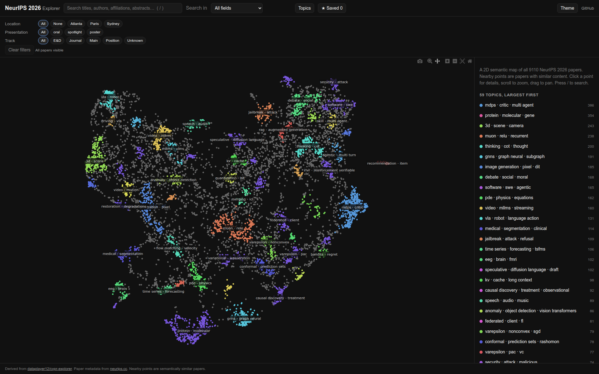
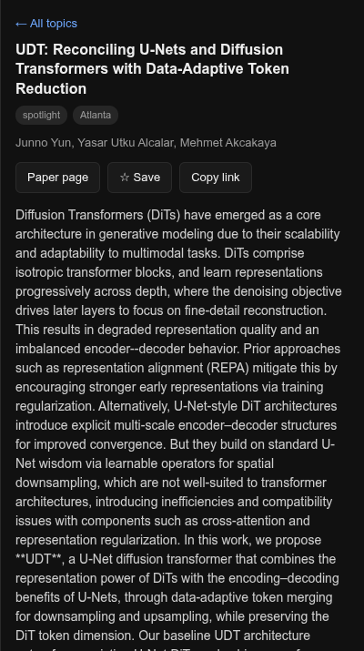

# NeurIPS 2026 Explorer

A 2D semantic map of the accepted NeurIPS 2026 papers, built from
[SPECTER2](https://huggingface.co/allenai/specter2) embeddings of titles and abstracts.
Nearby points are semantically similar papers, so a cluster is a topic.

**Live site: https://flecomet.github.io/neurips-explorer/**

Derived from [flecomet/cvpr-explorer](https://github.com/flecomet/cvpr-explorer). See
[Credits](#credits).

[](https://flecomet.github.io/neurips-explorer/)


## Status

The repository contains paper metadata, embeddings, and a generated map layout for 9,110
distinct paper titles supported by the virtual site. This is source coverage, not an independently
verified acceptance total. The Pages workflow builds the browser payloads and publishes `site/`.

The 11 October data refresh removed 56 duplicate records from a 9,167-record scrape and excluded
one previous record whose paper page returned HTTP 404. It retains 126 alternative identifiers
so saved papers and shared paper links resolve to the corresponding current paper. Text vectors
were reused for 8,693 identical model inputs from the completed refresh and recomputed for 417
papers. Input hashes and the excluded record are in [the refresh provenance](docs/data-refresh-2026-10-11.json).

- **OpenReview** has not released the 2026 papers (the venue group has `public_submissions = false`,
  and every 2026 query returns 0 notes while 2025 returns papers). It also answers scripts running
  on GitHub's servers with a human-verification challenge. `scrape.py` (OpenReview) is kept for
  when the papers are published.
- **neurips.cc** already lists the accepted papers per location (Sydney, Atlanta, Paris). Its
  listing pages are rendered by JavaScript from two JSON files
  (`/static/virtual/data/neurips-2026-orals-posters.json` and `...-abstracts.json`), which
  `scrape_site.py` downloads. The abstract extraction from a paper page was checked against the real
  site. The layout of the two JSON files was not known when the parser was written, so field names
  are looked up from lists of likely candidates, and every run prints the structure it found.
  `python scrape_site.py --probe` prints that structure without writing anything.
  Papers absent from the listing are recovered from their pages. Previous identifiers become
  aliases for matching titles; a previous-only title is retained only after its page and abstract
  are verified. The site build rejects duplicate titles and conflicting aliases.

## Features

- Map of all papers with topic names drawn on it; more names appear as you zoom in.
- Filter papers by location, presentation type, and track. Choose one or more options in each filter
  to refine your search or selected topic.
  Track choices are Main, E&D (Evaluations & Datasets), Position, Journal, and Unknown.
  Unknown retains papers without a verified track assignment.
  Main has five submission contribution types: General, Theory, Use-Inspired,
  Concept & Feasibility, and Negative Results, as described in the
  [2026 Main Track Handbook](https://neurips.cc/Conferences/2026/MainTrackHandbook#contribution-type).
  These are separate from submission tracks and presentation types. The public listing does
  not provide each paper's contribution type, so filtering by these types is not yet available.
- Topics list: click a topic to zoom to it and list its papers.
- Search over titles, authors, keywords, TL;DR and abstracts. Matches stay in place, grow larger,
  and receive contrasting outlines while the rest dim. Topic colors remain visible in both themes.
- Author search: choose Authors to preview papers by partial name, then select suggestions to build a manual group.
  Suggestions distinguish NeurIPS accounts using their institution and account identifier.
  Rounded author buttons in paper details select that account when an identifier is available. Results count shared papers once, show topic counts,
  and offer Fit matching papers without changing the viewport automatically.
- Paper panel: abstract, TL;DR, keywords (click to search), PDF and OpenReview links, and the six
  most similar papers.
- Save papers to a list kept in the browser (localStorage), export as CSV or Markdown.
- Shareable URLs: `?p=<paper id>`, `?q=<search>`, `?c=<topic>`, `?location=Atlanta&location=Paris&presentation=oral`,
  `?track=Position&location=Paris`,
  and `?scope=authors&author-id=neurips:149508`. Name-only selections use `author-id=name:<normalized name>`.
  Legacy `author=<name>` links select every account and unverified name group with that full name.
  Author selections persist when opening or saving papers.
- Light and dark themes, keyboard shortcuts (`/` search, `Esc` clear), usable on a phone.
- Fast start: the map (`data.json`, a few hundred KB gzipped) loads first, abstracts
  (`details.json`) load afterwards.

## Reading the map

Each point is one paper. Position comes from the title and abstract: papers with similar text
land close together. Colours mark topics, and topic names are drawn on the map. Papers that fit
no topic share one neutral colour and are listed as "unclustered".

Clicking a point opens the paper panel, shown here.



Author groups are assembled manually. For 5,815 of the 9,110 papers, author identities and institutions come from
the public NeurIPS listing. Publications are grouped by NeurIPS account identifier, so accounts sharing a name stay
separate. Selecting an account excludes papers whose authors have no identifier. An account identifier identifies
a NeurIPS account; one person may have several accounts.

The remaining 3,295 papers use name-only groups marked "identity not verified". Identical full names can combine
papers across people within these groups, while spelling variants remain separate. Name matching ignores case,
Unicode representation, and extra whitespace, but preserves accents and punctuation.

The author enrichment matched both the title and the complete ordered author list before attaching identifiers.
One further title matched the source, but its local author list contains a repeated name and was left unverified.
The [enrichment provenance](docs/author-identities-2026-10-11.json) records coverage and preservation checks.

Track labels come from the listing's `sourceurl`, which identifies the OpenReview submission venue or a journal
track spreadsheet. The 12 October enrichment combined three downloaded listings from 11 and 12 October,
matching the title plus either an event identifier or the complete author list. Conflicting assignments remain
Unknown. Of the 9,110 papers, 7,803 are Main, 967 E&D, 136 Position, 85 Journal, and 119 Unknown.
The [track enrichment provenance](docs/track-enrichment-2026-10-12.json) records source hashes and preservation checks.

Distances are approximate. UMAP, the 2D projection method, preserves local neighbourhoods
better than global distances. Read "these two papers are close" as meaningful, and "this topic
is twice as far away as that one" as unreliable.

## Largest topics

The pipeline finds 59 topics. A further 3,758 of the 9,110 papers (41%) belong to none of them.
Topic names are generated automatically from the paper text.

| Papers | Topic name |
|-------:|------------|
| 386 | mdps · critic · multi agent |
| 354 | protein · molecular · gene |
| 243 | 3d · scene · camera |
| 238 | muon · relu · recurrent |
| 200 | thinking · cot · thought |
| 191 | gnns · graph neural · subgraph |
| 185 | image generation · pixel · dit |
| 168 | debate · social · moral |

## How it works

The pipeline is offline and the site is static (no backend, no API keys at serve time).

| Step | Script | Output |
|------|--------|--------|
| Fetch accepted papers from neurips.cc (or OpenReview) | `scrape_site.py` (`scrape.py`) | `data/neurips_2026_papers.json` |
| Embed title + abstract with SPECTER2 | `embed.py` | `data/neurips_2026_specter2.npy` (float16) |
| UMAP to 2D, HDBSCAN clusters, TF-IDF topic names, nearest neighbours | `layout.py` | `data/neurips_2026_layout.json` |
| Merge into the site payload | `build_site.py` | `site/data.json`, `site/details.json` |

`layout.py` runs UMAP on the cosine-normalised embeddings, then HDBSCAN, a density-based
clustering method, on the 2D coordinates. Topic names use TF-IDF: terms score high when they
are frequent in one topic and rare in the others.

`templates/index.html` is the page template. `build_site.py` writes it to `site/index.html`,
which renders the payload client-side with plotly.js.

## Setup

1. Create the GitHub repository (public: GitHub Pages is free only for public repositories),
   push this code to `main`.
2. Settings, Pages, Source: **GitHub Actions**.
3. When `data/neurips_2026_layout.json` is present, run **Deploy site to GitHub Pages** in the
   Actions tab. To generate or refresh the data, run **Refresh data** with source `neurips.cc`.
   It runs the whole pipeline on a GitHub runner, commits `data/`, and starts the Pages
   deployment. Embedding on a CPU takes tens of minutes. The **Probe neurips.cc** step prints
   what the site returned; if scraping fails, that output shows what the parser needs to change.
4. Other sources: `committed` uses `data/neurips_2026_papers.json` as it is in the repository.
   `openreview` does not work from GitHub runners (human-verification challenge). Once OpenReview
   publishes the papers, scrape from your own machine with `python scrape.py`. Commit the data
   and run the workflow with source `committed`. The venue ids are in [`config.py`](config.py).

## Run locally

When paper metadata, text vectors, and layout are already regenerated together, merging them
to `main` starts the Pages deployment. No new scrape or Refresh data run is required. For the
11 October cleaned dataset, use the integration pull request instead of the earlier data-only
refresh pull request, which still contains duplicate records.

To view the committed paper data and map layout, build the browser payloads and serve them:

```shell
python build_site.py
python -m http.server --directory site 8000
```

Open http://localhost:8000/. Opening `site/index.html` directly as a local file prevents the
browser from fetching the paper data. `site/data.json` and `site/details.json` are generated
files and are rebuilt after cloning or updating the repository.

To add author identifiers to existing paper metadata, download the public NeurIPS listing JSON and use it as a
local snapshot. This updates author metadata while preserving paper order, titles, abstracts, embeddings, and map
layout. Rebuild the site afterwards; the embedding and layout stages do not need to run.

```shell
python scrape_site.py --enrich-authors /path/to/neurips-2026-orals-posters.json
python build_site.py
```

Track enrichment also works from downloaded listing JSON files. Multiple snapshots improve coverage when the
live listing omits previously published papers. Only track metadata changes; paper order and map layout remain
unchanged. A repeated `--enrich-tracks` combines snapshots before checking for conflicting assignments.

```shell
python scrape_site.py --enrich-tracks /path/to/listing.json --enrich-tracks /path/to/earlier-listing.json
python build_site.py
```

To regenerate the paper data, embeddings, and layout:

```shell
pip install -r requirements-pipeline.txt
python scrape_site.py   # neurips.cc; for OpenReview: python scrape.py
python embed.py         # GPU recommended, CPU works
python layout.py        # --min-cluster-size 25 --n-neighbors 15
python build_site.py
python -m http.server -d site 8000   # http://localhost:8000
```

Tests: `pip install -r requirements-dev.txt && python -m pytest`.

## Notes

- `layout.py` is deterministic for fixed inputs (UMAP `random_state=42`) so reruns keep the map
  stable. Changing the embeddings or paper set changes the map.
- Papers can end up "unclustered" at `--min-cluster-size 25`. Lower it for
  more, smaller topics.
- Saved papers never leave the browser.

## Shared template

This repository is the template source for the sister explorers, currently
[cvpr-explorer](https://github.com/flecomet/cvpr-explorer). The files listed in `SHARED` in
`sync_template.py` read every conference-specific value from `config.py`, and
`build_site.py` renders `templates/index.html` into `site/index.html`. Edit shared files
here, then copy them across:

    python sync_template.py ../cvpr-explorer --test    # run its tests with these files
    python sync_template.py ../cvpr-explorer --check   # list differing files
    python sync_template.py ../cvpr-explorer           # copy them
    python sync_template.py ../cvpr-explorer --commit  # copy and commit in a clean checkout

The "Sister explorers" workflow tests both repositories on pushes and pull requests.
After successful checks on `main`, it copies the shared files to the sister repository,
commits changes, and pushes its `main` branch. Manual workflow runs on `main` also sync.
Conference data, configuration, and README files remain specific to each repository.
The commit uses the source commit's author identity, and creates no commit when files match.

Automatic synchronization requires a repository Actions secret named `SISTER_SYNC_TOKEN`
in this repository. Use a fine-grained GitHub personal access token restricted to
`flecomet/cvpr-explorer`, with Contents and Workflows read and write permissions.
Workflows permission is required because the shared files include workflow definitions.
The token also lets the sister push trigger its tests and Pages deployment.
Without this secret, the sync job fails with a setup message; compatibility tests still run.
Sister branch protection must permit the token owner to push to `main`.

## Credits

Derived from [flecomet/cvpr-explorer](https://github.com/flecomet/cvpr-explorer), itself a fork
of [dataplayer12/cvpr-explorer](https://github.com/dataplayer12/cvpr-explorer). The original
idea and design are by [@dataplayer12](https://github.com/dataplayer12). Same licence as
upstream, see [LICENSE](LICENSE).
